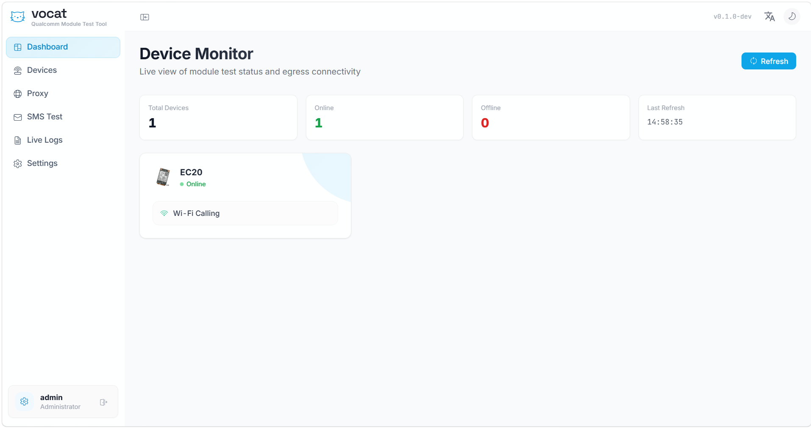
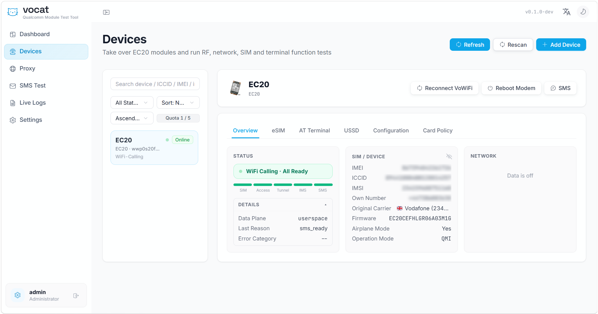

<p align="center">
  
</p>

<h1 align="center">VoNet</h1>

<p align="center">
  
  
  
  
  
  
</p>

<p align="center">
  
  
  
  
  
  
</p>

[English](../README.md) | **العربية** | [简体中文](README.zh-CN.md) | [繁體中文](README.zh-TW.md) | [Français](README.fr.md) | [Русский](README.ru.md) | [Español](README.es.md) | [日本語](README.ja.md)

VoNet هي لوحة تحكم ويب مفتوحة المصدر ومجموعة أدوات هندسية لمودمات Quectel الخلوية من فئة EC20/EC25. تجمع في خدمة واحدة مكتفية ذاتيًا بين اكتشاف المودم، وحالة الراديو المباشرة، وطرفيات AT وUSSD، والرسائل القصيرة SMS، وWiFi Calling، وإدارة eSIM، واختيار الشبكة، والتوجيه عبر البروكسي، والإشعارات، وسجلات التدقيق، وأتمتة الإصدارات.

الواجهة الخلفية مكتوبة بلغة Go، والواجهة مبنية باستخدام React وTypeScript، وتُضمَّن واجهة الإنتاج الأمامية داخل الملف الثنائي لـ Go. يحتوي ملف تنفيذي واحد على تطبيق الويب ويستخدم SQLite للحالة الدائمة.

<p align="center">
  
  
</p>

## الميزات

| المجال | ما يوفره VoNet |
| --- | --- |
| إدارة الأجهزة | اكتشاف تلقائي عبر المنفذ التسلسلي/USB، دعم عدة مودمات، أسماء أجهزة مألوفة، تحديثات مباشرة للنظرة العامة، إعادة تشغيل الوحدة، وضع الطيران، وضوابط وضع شبكة USB. |
| الراديو والشبكة | حالة التسجيل، المشغّل، مقاييس الإشارة، RSRP/RSRQ/SINR، وضع الشبكة، النطاق، القناة، فحص المشغّلين، والاختيار التلقائي أو اليدوي للشبكة. |
| AT وUSSD | طرفية AT تفاعلية، سجل الأوامر، استجابات المودم الخام، تدفقات بدء/متابعة/إلغاء USSD، والإبلاغ الواضح عن أخطاء المودم. |
| الرسائل القصيرة | إرسال مباشر للرسائل الخلوية ورسائل IMS، المزامنة الواردة، التعامل مع الرسائل متعددة الأجزاء، تقارير التسليم، سجل المحادثات، حالة عدم القراءة، الطوابع الزمنية، وحالة التسليم لكل رسالة. |
| WiFi Calling | إنشاء نفق IKEv2/ePDG، مصادقة EAP-AKA، تسجيل IMS، رسائل IMS القصيرة، ضوابط إعادة الاتصال، تشخيصات الحالة، والتوجيه لكل جهاز. |
| eSIM وeUICC | اكتشاف eUICC، ومعلومات EID والإنتاج، والبيانات الوصفية للشهادات، وجرد متعدد لـ eUICC، وقائمة الملفات الشخصية المثبتة، وعمليات التمكين/التعطيل/التبديل، وعمليات التنزيل وإعادة التسمية والحذف عندما تدعمها البطاقة. |
| سياسة البطاقة | سلوك WiFi Calling ووضع الطيران بناءً على ICCID مع تطبيق فوري للسياسة. |
| التوجيه عبر البروكسي | توجيه SOCKS صاعد، ربط الأجهزة، قواعد الدول، فحوصات الوصول عبر TCP، وفحوصات UDP Associate لمسارات بيانات WiFi Calling. |
| الإشعارات | إعادة توجيه الرسائل القصيرة الواردة الجديدة عبر Telegram وBark والبريد الإلكتروني وPushplus وwebhooks الموقّعة. يتم تسليم كل رسالة كإشعار منفصل. |
| بوت Telegram | حالة الجهاز، قائمة الملفات الشخصية المثبتة وتبديلها، ضوابط WiFi Calling، وإرسال الرسائل القصيرة. تتطلب الإجراءات الحساسة تأكيد المسؤول. |
| العمليات | المصادقة، الحماية من CSRF، سياسات الوصول، أحداث التدقيق، السجلات المباشرة، الاحتفاظ بالسجلات، فحوصات الصحة، تخطيط متجاوب، الوضع الداكن، وواجهة مستخدم بالإنجليزية/الصينية. |
| التوزيع | ملفات Linux الثنائية الثابتة، سكربت تثبيت systemd، تحديث ذاتي مع التحقق من SHA-256، صورة Docker، النشر إلى GHCR، وبنى إصدارات GitHub Actions. |

## الأجهزة المدعومة

يستهدف VoNet وحدات Quectel المبنية على Qualcomm والتي توفر واجهات AT وQMI والمنفذ التسلسلي وشبكة USB المتوافقة، بما في ذلك:

- Quectel EC20
- Quectel EC25
- عائلة Quectel EG25
- وحدات EG600 المتوافقة وذات الصلة

تعتمد الميزات المتاحة على برنامج الوحدة الثابت (firmware)، وتكوين USB، وقدرات SIM/eSIM، وتعريفات المضيف، والشبكة اللاسلكية، وإعدادات المشغّل.

## التثبيت

### تثبيت Linux بنقرة واحدة

بصفتك root (بما في ذلك OpenWrt/Kwrt، حيث يكون `sudo` غير موجود عادةً):

```bash
curl -fsSL https://raw.githubusercontent.com/springai/VoNet/master/scripts/install.sh | bash
```

من مستخدم عادي على توزيعة تحتوي على sudo:

```bash
curl -fsSL https://raw.githubusercontent.com/springai/VoNet/master/scripts/install.sh | sudo bash
```

تحقق من متطلبات VoWiFi/XFRM على المضيف دون تثبيت VoNet:

```bash
curl -fsSL https://raw.githubusercontent.com/springai/VoNet/master/scripts/install.sh | bash -s -- --check-env
```

تثبيت إصدار محدد:

```bash
curl -fsSL https://raw.githubusercontent.com/springai/VoNet/master/scripts/install.sh -o install.sh
sudo bash install.sh 0.0.2
```

يتطلب VoWiFi IMS وجود Linux XFRM/IPsec. على OpenWrt/Kwrt يحاول المثبّت
تثبيت الحزم المطابقة `ip-full` و`kmod-ipsec` و`kmod-ipsec4/6`
و`kmod-crypto-authenc` وAES-CBC وSHA1 من مستودع البرنامج الثابت نفسه.
إذا لم تكن وحدات النواة المطابقة متاحة، فاستخدم برنامجًا ثابتًا يتضمنها؛
ولا تفرض أبدًا تثبيت kmods مبنية لنواة مختلفة.

إذا كانت النواة لا تستطيع توفير XFRM/IPsec وكنت تحتاج فقط إلى ميزات لا تعتمد على VoWiFi، مثل الرسائل القصيرة الخلوية أو البيانات، فثبّت باستخدام `--skip-vowifi-check`:

```bash
curl -fsSL https://raw.githubusercontent.com/springai/VoNet/master/scripts/install.sh -o install.sh
sudo bash install.sh --skip-vowifi-check
```

المثبّت:

- يكتشف `amd64` أو `386` أو `arm64` أو `aarch64` أو `armv7`؛
- ينزّل الملف الثنائي المطابق من GitHub Release؛
- يتحقق منه مقابل `SHA256SUMS`؛
- يثبّت VoNet في `/opt/vonet`؛
- ينشئ خدمة systemd محصّنة بوصول الأجهزة والشبكة الذي يتطلبه VoNet؛
- يخزّن إعدادات وقت التشغيل في `/etc/vonet/env`؛
- يولّد كلمة مرور مسؤول أولية عشوائية عند التثبيت الأول.

بعد التثبيت، افتح:

```text
http://<server-address>:17575
```

### التثبيت اليدوي للملف الثنائي

نزّل الملف الثنائي المطابق و`SHA256SUMS` من GitHub Releases:

| المنصة | ملف الإصدار |
| --- | --- |
| Linux x86-64 | `vonet-linux-amd64` |
| Linux x86 32-بت | `vonet-linux-386` |
| Linux ARM64 | `vonet-linux-arm64` |
| Linux AArch64 | `vonet-linux-aarch64` |
| Linux ARMv7 | `vonet-linux-armv7` |

تحقق منه وثبّته:

```bash
sha256sum -c SHA256SUMS --ignore-missing
sudo install -d -m 0755 /opt/vonet/bin /opt/vonet/data
sudo install -m 0755 vonet-linux-amd64 /opt/vonet/bin/vonet
read -rsp "Admin password: " VONET_BOOTSTRAP_PASSWORD; echo
printf '%s\n' "$VONET_BOOTSTRAP_PASSWORD" | sudo /opt/vonet/bin/vonet bootstrap-admin
unset VONET_BOOTSTRAP_PASSWORD
sudo env \
  VONET_DATABASE_PATH=/opt/vonet/data/vonet.db \
  /opt/vonet/bin/vonet serve
```

يشغّل هذا الأمر اليدوي VoNet في المقدمة. استخدم `vonet serve` حتى
تبدأ العملية تشغيل الخادم مباشرةً؛ إن تشغيل `vonet` دون وسائط بصفتك root
على TTY يفتح بدلاً من ذلك قائمة الإدارة التفاعلية. استخدم المثبّت بنقرة
واحدة عند الحاجة إلى خدمة systemd مُدارة وإعادة تشغيل تلقائية.

### Docker

لمضيف Linux الذي يجب أن يكتشف كل مودم Quectel مدعوم متصل ويواصل
رؤية أحداث التوصيل الساخن لـ USB، شغّل VoNet في وضع الوصول إلى الأجهزة:

```bash
docker pull ghcr.io/mengmengcode/vonet:latest

read -rsp "Admin password: " VONET_BOOTSTRAP_PASSWORD; echo
printf '%s\n' "$VONET_BOOTSTRAP_PASSWORD" | docker run --rm -i \
  --user 0:0 \
  -v vonet-data:/opt/vonet/data \
  --entrypoint /opt/vonet/bin/vonet \
  ghcr.io/mengmengcode/vonet:latest bootstrap-admin
unset VONET_BOOTSTRAP_PASSWORD

docker run -d \
  --name vonet \
  --restart unless-stopped \
  --network host \
  --privileged \
  --user 0:0 \
  -v vonet-data:/opt/vonet/data \
  -v /dev:/dev \
  -v /sys:/sys:ro \
  ghcr.io/mengmengcode/vonet:latest
```

افتح `http://<server-address>:17575` بعد بدء الحاوية. يلزم استخدام شبكة المضيف حتى تبقى واجهات شبكة QMI مرئية لـ VoNet، كما يلزم الوصول بصلاحيات مرتفعة إلى الأجهزة لاستخدام المنافذ التسلسلية وعقد تحكم QMI وواجهات TUN وإعدادات الشبكة والأجهزة المضافة بعد بدء الحاوية. يتيح الربط المباشر لـ `/dev` ظهور عقد `ttyUSB*` و`ttyACM*` و`cdc-wdm*` الجديدة وعقد MHI من نمط `wwan*` دون إعادة إنشاء الحاوية.

يمنح هذا الوضع VoNet عمدًا وصولًا واسعًا إلى أجهزة المضيف ومكدس الشبكة. استخدمه فقط على مضيف Linux موثوق. يتعرّف الاكتشاف التلقائي على مودمات Quectel USB المدعومة (معرّف مورّد USB هو `2c7c`) ومودمات PCIe/MHI التي يتيحها نظام Linux WWAN الفرعي؛ ولا يتعرّف على جميع ترتيبات المودمات الممكنة. إن تعيين عقد فردية فقط باستخدام `--device`، مثل `/dev/ttyUSB2` أو `/dev/cdc-wdm0` أو `/dev/wwan0qmi0`، يحصر الحاوية في تلك العقد الثابتة ولا يوفّر اكتشافًا كاملًا لعدة أجهزة أو للأجهزة الموصولة أثناء التشغيل.

تُنشر صورة GHCR لـ `linux/amd64` و`linux/arm64`.

> [!TIP]
> **ملاحظة النشر على NAS / QNAP Container Station**:
> في أنظمة تشغيل NAS مثل QNAP QTS / QuTS hero (Container Station)، قد تؤدي حسابات المسؤولين المخصصة التي لا تعمل بصلاحيات root وآليات عزل وحدات التخزين إلى إسناد وحدات تخزين Docker المسماة (مثل `-v vonet-data:/opt/vonet/data`) إلى مسارات معزولة مختلفة بين التهيئة لمرة واحدة باستخدام `bootstrap-admin` وحاوية الخدمة العاملة في الخلفية، مما يسبب أخطاء «كلمة المرور غير صحيحة» عند تسجيل الدخول عبر الويب.
> في بيئات NAS، يوصى بشدة باستبدال وحدات التخزين المسماة بربط مباشر لمسار مطلق على المضيف (مثل `-v /share/Container/vonet/data:/opt/vonet/data` على QNAP) لكل من التهيئة والتشغيل، لضمان اتساق التخزين الدائم لقاعدة بيانات SQLite.

### قارئات SIM عبر USB

تستخدم قارئات SIM عبر USB خدمة Linux PC/SC. عند استخدام مدير حزم مدعوم، يثبّت برنامج التثبيت بنقرة واحدة `pcscd` ويشغّله تلقائيًا، كما يثبّت برنامج تشغيل CCID. على Debian/Ubuntu، يكون الإعداد اليدوي المكافئ هو `apt install pcscd libccid`. إذا اكتشف USB قارئ CCID ولكن PC/SC غير متاح، يُبقي VoNet القارئ ظاهرًا في مربع حوار إضافة جهاز ويبلّغ عن الخدمة أو برنامج التشغيل المفقود بدلًا من إخفائه بصمت.

### أدوات سطر أوامر QMI

يستخدم VoNet الأداة `qmicli` للتحقق من جاهزية قناة تحكم QMI، و`qmi-proxy` لتعدد الإرسال في الوصول إليها. تُدار جلسات بيانات الحزم بواسطة عميل QMI WDS المدمج بدلًا من ملفات حالة CID/PDH الخاصة بـ `qmi-network`. يثبّت برنامج التثبيت بنقرة واحدة الأدوات المقابلة ويتحقق منها. للنشر اليدوي، يستخدم Debian/Ubuntu الأمر `apt install libqmi-utils`، ويستخدم Arch Linux الأمر `pacman -S libqmi`، ويستخدم Alpine الأمر `apk add qmi-utils`، ويستخدم OpenWrt الأمر `opkg install qmi-utils`.

يتحقق `vonet doctor --repair-dji-qmi` من وجود `qmicli` قبل تغيير أي ربط لبرنامج تشغيل USB أو تفعيل إشارة DTR. إذا كانت الأداة غير متاحة، يتوقف الأمر مع إرشاد لتثبيتها ويترك حالة الجهاز الحالية دون تغيير.

## الإعدادات

يقرأ VoNet ملف إعدادات JSON اختياريًا من `VONET_CONFIG`، ثم يطبق متغيرات البيئة `VONET_*`. متغيرات البيئة لها الأولوية.

| متغير البيئة | الافتراضي | الوصف |
| --- | --- | --- |
| `VONET_ADDR` | `0.0.0.0:17575` | عنوان الاستماع HTTP. |
| `VONET_DATABASE_PATH` | `./data/vonet.db` | مسار قاعدة بيانات SQLite. |
| `VONET_SESSION_TTL` | `24h` | مدة صلاحية جلسة المصادقة. |
| `VONET_SECURE_COOKIES` | `false` | تجاوز اختياري يفرض الحماية على كل الإدخالات؛ تُضبط حماية Cookie تلقائيًا لكل إدخال HTTP/HTTPS. |
| `VONET_SHUTDOWN_TIMEOUT` | `10s` | مهلة الإيقاف السلس. |
| `VONET_MAX_REQUEST_BODY_BYTES` | `1048576` | الحد الأقصى لحجم جسم طلب API. |
| `VONET_REPO` | `springai/VoNet` | مستودع GitHub الموثوق الذي يستخدمه المحدّث الذاتي، بصيغة `owner/name`. |
| `GITHUB_TOKEN` | فارغ | رمز GitHub اختياري للمستودعات الخاصة أو حدود API أعلى. |

يمكن تحويل حزم إعدادات مشغّلي Apple التي يوفّرها المستخدم باستخدام `vonet carrier import-ipcc` إلى ملفات إعداد مشغّلين قابلة للمراجعة ومقيّدة بقائمة عناصر مسموح بها؛ انظر [docs/CARRIER_IPCC_IMPORT.md](CARRIER_IPCC_IMPORT.md).

تُخزَّن بيانات اعتماد المسؤول في SQLite فقط. هيّئ قاعدة بيانات فارغة مرة واحدة باستخدام `vonet bootstrap-admin`؛ لا يمكن لمتغيرات البيئة أو إعدادات JSON تعيين اسم مستخدم المسؤول أو كلمة مروره أو الكتابة فوقهما.

لا تخزّن رموز Telegram، أو كلمات مرور SMTP، أو أسرار webhook، أو بيانات اعتماد SIM، أو بيانات خاصة أخرى في المستودع. قم بإعدادها عبر إعدادات التطبيق أو ملفات البيئة المحمية.

## بوت Telegram

عند تفعيل إشعارات Telegram وإعداد كلٍّ من Chat ID وAdmin ID، يدعم البوت:

```text
/status [device]
/esim <device>
/switch <device> <iccid>
/wfc <device> <status|on|off|reconnect>
/sms <device> <number> <message>
```

تستخدم عمليتا تبديل الملفات الشخصية وإرسال الرسائل القصيرة أزرار تأكيد لمرة واحدة. لا يعرض البوت أوامر تنزيل أو حذف أو إعادة تسمية eSIM.

## التحديث

تحقق من وجود GitHub Release أحدث:

```bash
vonet update --check --repo springai/VoNet
```

ثبّت أحدث إصدار:

```bash
sudo vonet update --repo springai/VoNet
```

ينزّل المحدّث الملف الثنائي المطابق لبنية Linux الحالية، ويتحقق منه باستخدام `SHA256SUMS` المنشور، ويستبدل الملف التنفيذي بشكل ذري، ويعيد تشغيل خدمة systemd `vonet` عند توفرها.

لتثبيتات Docker:

```bash
docker pull ghcr.io/mengmengcode/vonet:latest
```

أعد إنشاء الحاوية بعد سحب الصورة الجديدة.

## إدخالات SSO متعددة والترجيع

تعمل إعدادات SSO والربط الخارجي المحفوظة مع نقطة HTTPS عامة مهيّأة ومع نقاط
محلية/خاصة صريحة فوق HTTP أو HTTPS. سجّل كل callback كامل
(`/api/auth/sso/callback`) لدى مزوّد الهوية. يُجمَّد callback عند إنشاء flow،
وتُرفض العودة عبر نقطة أخرى. يُقبل HTTP فقط مع localhost وloopback وعناوين
IP خاصة حرفيّة، وليس مع أسماء DNS خاصة أو أي host عام. تستخدم عناوين IPv6
صيغة المتصفح المضغوطة، بما في ذلك عناوين IPv4-mapped الست عشرية.

ملفات تعريف ارتباط Session وCSRF تكون host-only، لذلك تتشارك نقاط الدخول
الإعدادات والربط لكن لا تتشارك Session بين المضيفات. تُختار حماية Secure
تلقائيًا لكل نقطة حسب النقل أو إشارة `X-Forwarded-Proto` الموثوقة. يفرض
`VONET_SECURE_COOKIES=true` الحماية على كل النقاط؛ وعند استخدام HTTP فقط يمنع
إصدار Cookie اللازم ويوقف تسجيل الدخول أو تحديث Session. يجب على reverse
proxy حفظ `Host` الأصلي وإزالة رؤوس `Forwarded` و`X-Forwarded-*` غير الموثوقة.

يستخدم VoNet schema 35 مع الحفاظ على migration 33 لرموز API وmigration 34
لتخزين SSO وجميع جداول العمل المحلية؛ وتنشئ schema 35 فقط عمود
`sessions.secure_cookies`. بعد استعادة نسخة قاعدة بيانات، شغّل
`vonet auth-cleanup --database /opt/vonet/data/vonet.db` قبل إعادة الخدمة. يحفظ
الأمر الإعدادات والربط، ويؤجل رموز API وSession ويحذف flow المعلّقة. لا يوجد
ترجيع تلقائي لـ schema 35؛ استعد النسخة المطابقة السابقة للترقية.

## التطوير

المتطلبات:

- Go 1.27.3 أو أحدث
- Node.js 20 أو أحدث
- npm

تشغيل خادم تطوير الواجهة الأمامية:

```bash
cd web
npm install
npm run dev
```

بناء الواجهة الأمامية المضمّنة وتشغيل الواجهة الخلفية:

```bash
cd web
npm run build
cd ..
go run ./cmd/vonet
```

تشغيل جميع الاختبارات:

```bash
go test ./...
```

بناء ملف ثنائي للإنتاج:

```bash
go build -trimpath -ldflags "-s -w" -o vonet ./cmd/vonet
```

## أتمتة الإصدارات

يؤدي دفع وسم الإصدار إلى بدء سير عملَي GitHub Actions:

- `release-binaries` يبني وينشر ملفات `amd64` و`386` و`arm64` و`aarch64` و`armv7` الثنائية مع `SHA256SUMS`.
- `docker` يبني وينشر صورة متعددة البنى إلى GitHub Container Registry.

```bash
git tag v0.2.0
git push origin v0.2.0
```

## بنية المشروع

```text
cmd/vonet/                  نقطة دخول التطبيق وCLI
internal/device/            اكتشاف المودم والتحكم في الأجهزة
internal/modem/             جلسة AT ومعالجة الاستجابات
internal/server/            واجهة HTTP API والإشعارات وخادم الويب المضمّن
internal/store/             التخزين الدائم SQLite
internal/update/            المحدّث الذاتي لـ GitHub Release
internal/vowifi/            بيئة تشغيل IKE وEAP-AKA وIMS وWiFi Calling
scripts/install.sh          مثبّت ومحدّث Linux
web/src/                    الواجهة الأمامية React وTypeScript
.github/workflows/          أتمتة إصدارات الملفات الثنائية وDocker
```

## الاستخدام المسؤول

يمكن أن تؤثر عمليات المودم الخلوي وeSIM في خدمة المشترك، والملفات الشخصية المخزنة، وتسجيل الشبكة، وحالة الأجهزة. احتفظ بنسخ احتياطية، وراجع الإجراءات المدمّرة بعناية، واستخدم البرنامج فقط في بيئات قانونية يُسمح لك فيها بتشغيل الأجهزة وموارد الشبكة المتصلة.

لا يتجاوز VoNet مصادقة المشغّل، أو سياسة الشبكة، أو أمان الأجهزة، أو متطلبات الثقة لـ eSIM. إن دعم عملية ما يعني أن VoNet يمكن أن يطلبها من المودم أو eUICC؛ وقد يرفضها الجهاز أو الملف الشخصي أو الشبكة أو المشغّل مع ذلك.

## المساهمة

نرحّب بالمسائل (issues) وطلبات السحب (pull requests). حافظ على التغييرات مركّزة، وأضِف الاختبارات حيثما أمكن، وتجنّب إيداع بيانات الاعتماد أو بيانات المشتركين، ووثّق بوضوح السلوك الخاص بالأجهزة.

قبل إرسال تغيير:

```bash
go test ./...
cd web && npm run build
```

## شكر وتقدير
- [Nodeseek.com](https://www.nodeseek.com) — مجتمع مكرّس للخوادم
- [Linux.do](https://linux.do) — مجتمع تقني ملهم
- [iniwex5](https://github.com/iniwex5) — إرشادات الأسلوب والوظائف

## الرخصة

انظر [LICENSE](../LICENSE).

<a href="https://star-history.dera.page/#springai/VoNet">
 <picture>
   <source media="(prefers-color-scheme: dark)" srcset="https://star-history.dera.page/svg?repos=springai/VoNet&theme=dark" />
   <source media="(prefers-color-scheme: light)" srcset="https://star-history.dera.page/svg?repos=springai/VoNet" />
   
 </picture>
</a>
