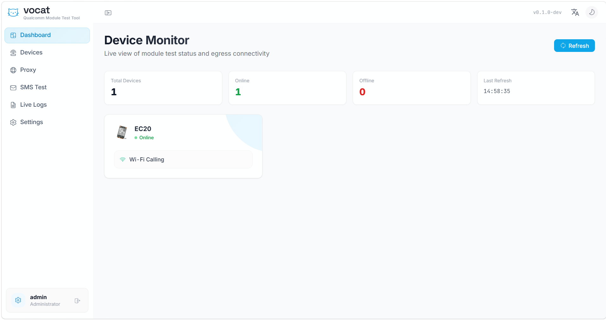
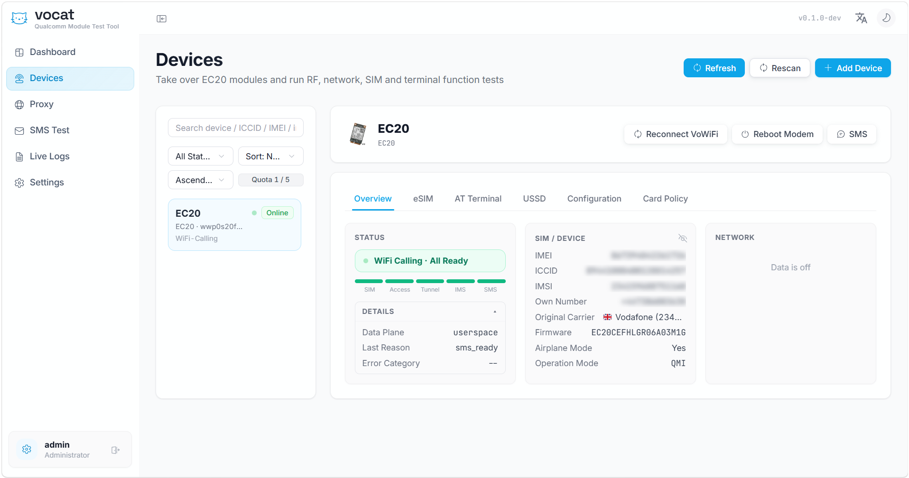

<p align="center">
  
</p>

<h1 align="center">VoNet</h1>

<p align="center">
  
  
  
  
  
  
</p>

<p align="center">
  
  
  
  
  
  
</p>

[English](../README.md) | [العربية](README.ar.md) | [简体中文](README.zh-CN.md) | [繁體中文](README.zh-TW.md) | **Français** | [Русский](README.ru.md) | [Español](README.es.md) | [日本語](README.ja.md)

VoNet est un panneau de contrôle web open-source et une boîte à outils d'ingénierie pour les modems cellulaires Quectel de classe EC20/EC25. Il réunit, dans un service autonome unique, la découverte de modems, l'état radio en direct, les terminaux AT et USSD, les SMS, les appels WiFi (WiFi Calling), la gestion eSIM, la sélection de réseau, le routage par proxy, les notifications, les journaux d'audit et l'automatisation des versions.

Le backend est écrit en Go, l'interface est construite avec React et TypeScript, et le frontend de production est intégré dans le binaire Go. Un seul exécutable contient l'application web et utilise SQLite pour l'état persistant.

<p align="center">
  
  
</p>

## Fonctionnalités

| Domaine | Ce que VoNet fournit |
| --- | --- |
| Gestion des appareils | Découverte série/USB automatique, prise en charge de plusieurs modems, noms d'appareils conviviaux, mises à jour en direct de la vue d'ensemble, redémarrage du module, mode avion et contrôles du mode réseau USB. |
| Radio et réseau | État d'enregistrement, opérateur, métriques de signal, RSRP/RSRQ/SINR, mode réseau, bande, canal, recherche d'opérateurs et sélection de réseau automatique ou manuelle. |
| AT et USSD | Terminal AT interactif, historique des commandes, réponses brutes du modem, flux de démarrage/poursuite/annulation USSD et rapport d'erreurs modem clair. |
| SMS | Envoi direct de SMS cellulaires et IMS, synchronisation entrante, gestion des messages multiparties, rapports de livraison, historique des conversations, état non lu, horodatages et statut de livraison par message. |
| WiFi Calling | Établissement de tunnel IKEv2/ePDG, authentification EAP-AKA, enregistrement IMS, SMS IMS, contrôles de reconnexion, diagnostics d'état et routage par appareil. |
| eSIM et eUICC | Découverte eUICC, EID et informations de production, métadonnées de certificat, inventaire multi-eUICC, liste des profils installés, opérations d'activation/désactivation/commutation, ainsi que téléchargement, renommage et suppression lorsque la carte le permet. |
| Politique de carte | Comportement WiFi Calling et mode avion basé sur l'ICCID avec application immédiate de la politique. |
| Routage par proxy | Routage SOCKS amont, liaisons d'appareils, règles par pays, vérifications d'accessibilité TCP et vérifications UDP Associate pour les chemins de données WiFi Calling. |
| Notifications | Transfert des nouveaux SMS entrants via Telegram, Bark, e-mail, Pushplus et webhooks signés. Chaque SMS est livré comme une notification individuelle. |
| Bot Telegram | État de l'appareil, liste et commutation des profils installés, contrôles WiFi Calling et envoi de SMS. Les actions sensibles nécessitent une confirmation de l'administrateur. |
| Exploitation | Authentification, protection CSRF, politiques d'accès, événements d'audit, journaux en direct, rétention des journaux, vérifications de santé, mise en page réactive, mode sombre et interface utilisateur en anglais/chinois. |
| Distribution | Binaires Linux statiques, script d'installation systemd, auto-mise à jour avec vérification SHA-256, image Docker, publication GHCR et builds de version GitHub Actions. |

## Matériel pris en charge

VoNet cible les modules Quectel à base Qualcomm qui exposent des interfaces AT, QMI, série et réseau USB compatibles, notamment :

- Quectel EC20
- Quectel EC25
- Famille Quectel EG25
- Modules EG600 compatibles et apparentés

Les fonctionnalités disponibles dépendent du firmware du module, de la composition USB, des capacités SIM/eSIM, des pilotes hôtes, du réseau radio et de la configuration de l'opérateur.

## Installation

### Installation Linux en un clic

En tant que root (y compris OpenWrt/Kwrt, où `sudo` est normalement absent) :

```bash
curl -fsSL https://raw.githubusercontent.com/springai/VoNet/master/scripts/install.sh | bash
```

Depuis un utilisateur normal sur une distribution disposant de sudo :

```bash
curl -fsSL https://raw.githubusercontent.com/springai/VoNet/master/scripts/install.sh | sudo bash
```

Vérifier les prérequis VoWiFi/XFRM de l'hôte sans installer VoNet :

```bash
curl -fsSL https://raw.githubusercontent.com/springai/VoNet/master/scripts/install.sh | bash -s -- --check-env
```

Installer une version spécifique :

```bash
curl -fsSL https://raw.githubusercontent.com/springai/VoNet/master/scripts/install.sh -o install.sh
sudo bash install.sh 0.0.2
```

VoWiFi IMS nécessite Linux XFRM/IPsec. Sur OpenWrt/Kwrt, le programme d'installation tente
d'installer les paquets correspondants `ip-full`, `kmod-ipsec`, `kmod-ipsec4/6`,
`kmod-crypto-authenc`, AES-CBC et SHA1 depuis le dépôt du firmware lui-même.
Si des modules noyau correspondants ne sont pas disponibles, utilisez un firmware qui les inclut ;
ne forcez jamais l'installation de kmods compilés pour un noyau différent.

Si votre noyau ne peut pas fournir XFRM/IPsec et que vous avez uniquement besoin de fonctionnalités sans VoWiFi, comme les SMS cellulaires ou les données, installez avec `--skip-vowifi-check` :

```bash
curl -fsSL https://raw.githubusercontent.com/springai/VoNet/master/scripts/install.sh -o install.sh
sudo bash install.sh --skip-vowifi-check
```

Le programme d'installation :

- détecte `amd64`, `386`, `arm64`, `aarch64` ou `armv7` ;
- télécharge le binaire GitHub Release correspondant ;
- le vérifie par rapport à `SHA256SUMS` ;
- installe VoNet sous `/opt/vonet` ;
- crée un service systemd renforcé disposant des accès matériel et réseau requis par VoNet ;
- stocke la configuration d'exécution dans `/etc/vonet/env` ;
- génère un mot de passe administrateur initial aléatoire lors de la première installation.

Après l'installation, ouvrez :

```text
http://<server-address>:7575
```

### Installation manuelle du binaire

Téléchargez le binaire correspondant et `SHA256SUMS` depuis GitHub Releases :

| Plateforme | Fichier de version |
| --- | --- |
| Linux x86-64 | `vonet-linux-amd64` |
| Linux x86 32 bits | `vonet-linux-386` |
| Linux ARM64 | `vonet-linux-arm64` |
| Linux AArch64 | `vonet-linux-aarch64` |
| Linux ARMv7 | `vonet-linux-armv7` |

Vérifiez-le et installez-le :

```bash
sha256sum -c SHA256SUMS --ignore-missing
sudo install -d -m 0755 /opt/vonet/bin /opt/vonet/data
sudo install -m 0755 vonet-linux-amd64 /opt/vonet/bin/vonet
read -rsp "Admin password: " VONET_BOOTSTRAP_PASSWORD; echo
printf '%s\n' "$VONET_BOOTSTRAP_PASSWORD" | sudo /opt/vonet/bin/vonet bootstrap-admin
unset VONET_BOOTSTRAP_PASSWORD
sudo env \
  VONET_DATABASE_PATH=/opt/vonet/data/vonet.db \
  /opt/vonet/bin/vonet serve
```

Cette commande manuelle exécute VoNet au premier plan. Utilisez `vonet serve` pour que le
processus démarre directement le serveur ; exécuter `vonet` sans argument en tant que root
sur un TTY ouvre plutôt le menu de gestion interactif. Utilisez le programme d'installation
en un clic lorsqu'un service systemd géré et un redémarrage automatique sont requis.

### Docker

Pour un hôte Linux qui doit découvrir chaque modem Quectel pris en charge connecté et
continuer à voir les événements de branchement à chaud USB, exécutez VoNet en mode d'accès matériel :

```bash
docker pull ghcr.io/mengmengcode/vonet:latest

read -rsp "Admin password: " VONET_BOOTSTRAP_PASSWORD; echo
printf '%s\n' "$VONET_BOOTSTRAP_PASSWORD" | docker run --rm -i \
  --user 0:0 \
  -v vonet-data:/opt/vonet/data \
  --entrypoint /opt/vonet/bin/vonet \
  ghcr.io/mengmengcode/vonet:latest bootstrap-admin
unset VONET_BOOTSTRAP_PASSWORD

docker run -d \
  --name vonet \
  --restart unless-stopped \
  --network host \
  --privileged \
  --user 0:0 \
  -v vonet-data:/opt/vonet/data \
  -v /dev:/dev \
  -v /sys:/sys:ro \
  ghcr.io/mengmengcode/vonet:latest
```

Ouvrez `http://<server-address>:7575` après le démarrage du conteneur. Le réseau de l'hôte est nécessaire pour que les interfaces réseau QMI restent visibles par VoNet, tandis que l'accès privilégié aux périphériques est nécessaire pour les ports série, les nœuds de contrôle QMI, les interfaces TUN, la configuration réseau et les périphériques ajoutés après le démarrage du conteneur. Le montage bind de `/dev` rend les nouveaux nœuds `ttyUSB*`, `ttyACM*`, `cdc-wdm*` et MHI `wwan*` visibles sans recréer le conteneur.

Ce mode donne intentionnellement à VoNet un large accès aux périphériques et à la pile réseau de l'hôte. Ne l'utilisez que sur un hôte Linux de confiance. La découverte automatique identifie les modems USB Quectel pris en charge (identifiant de fabricant USB `2c7c`) et les modems PCIe/MHI exposés par le sous-système Linux WWAN ; elle ne reconnaît pas toutes les configurations de modems. Le mappage de nœuds individuels uniquement avec `--device`, comme `/dev/ttyUSB2`, `/dev/cdc-wdm0` ou `/dev/wwan0qmi0`, limite le conteneur à ces nœuds fixes et ne permet pas une découverte complète de plusieurs périphériques ou des branchements à chaud.

L'image GHCR est publiée pour `linux/amd64` et `linux/arm64`.

> [!TIP]
> **Note de déploiement NAS / QNAP Container Station** :
> Sur les systèmes d'exploitation NAS tels que QNAP QTS / QuTS hero (Container Station), les comptes administrateur personnalisés non root et les mécanismes d'isolation des volumes peuvent faire pointer les volumes nommés Docker (par exemple `-v vonet-data:/opt/vonet/data`) vers des chemins isolés différents entre l'initialisation unique `bootstrap-admin` et le conteneur du service en arrière-plan, entraînant des erreurs « Mot de passe incorrect » lors de la connexion web.
> Pour les environnements NAS, il est fortement recommandé de remplacer les volumes nommés par un montage bind utilisant un chemin absolu de l'hôte (par exemple `-v /share/Container/vonet/data:/opt/vonet/data` sur QNAP), aussi bien pour l'initialisation que pour l'exécution, afin de garantir une persistance cohérente de la base de données SQLite.

### Lecteurs de cartes SIM USB

Les lecteurs de cartes SIM USB utilisent le service Linux PC/SC. Avec les gestionnaires de paquets pris en charge, le programme d'installation en un clic installe et démarre automatiquement `pcscd`, et installe le pilote CCID. Sur Debian/Ubuntu, la commande manuelle équivalente est `apt install pcscd libccid`. Si USB détecte un lecteur CCID mais que PC/SC est indisponible, VoNet laisse le lecteur visible dans la boîte de dialogue d'ajout d'appareil et signale le service ou le pilote manquant au lieu de le masquer silencieusement.

### Utilitaires QMI en ligne de commande

VoNet utilise `qmicli` pour vérifier qu'un canal de contrôle QMI est prêt et `qmi-proxy` pour en multiplexer l'accès. Les sessions de données par paquets sont gérées par le client QMI WDS intégré, plutôt que par les fichiers d'état CID/PDH de `qmi-network`. Le programme d'installation en un clic installe et vérifie les utilitaires correspondants. Pour un déploiement manuel, Debian/Ubuntu utilise `apt install libqmi-utils` ; Arch Linux utilise `pacman -S libqmi`, Alpine utilise `apk add qmi-utils` et OpenWrt utilise `opkg install qmi-utils`.

`vonet doctor --repair-dji-qmi` vérifie la présence de `qmicli` avant de modifier toute association de pilote USB ou d'activer le signal DTR. Si l'utilitaire est indisponible, la commande s'arrête avec une indication d'installation et laisse l'état actuel de l'appareil inchangé.

## Configuration

VoNet lit un fichier de configuration JSON optionnel depuis `VONET_CONFIG`, puis applique les variables d'environnement `VONET_*`. Les variables d'environnement ont la priorité.

| Variable d'environnement | Par défaut | Description |
| --- | --- | --- |
| `VONET_ADDR` | `0.0.0.0:7575` | Adresse d'écoute HTTP. |
| `VONET_DATABASE_PATH` | `./data/vonet.db` | Chemin de la base de données SQLite. |
| `VONET_SESSION_TTL` | `24h` | Durée de vie de la session d'authentification. |
| `VONET_SECURE_COOKIES` | `false` | Marque les cookies de session comme sécurisés lorsque HTTPS est utilisé. |
| `VONET_SHUTDOWN_TIMEOUT` | `10s` | Délai d'arrêt gracieux. |
| `VONET_MAX_REQUEST_BODY_BYTES` | `1048576` | Taille maximale du corps de requête API. |
| `VONET_REPO` | `springai/VoNet` | Dépôt GitHub de confiance utilisé par l'auto-updater, au format `owner/name`. |
| `GITHUB_TOKEN` | vide | Jeton GitHub optionnel pour les dépôts privés ou des limites d'API plus élevées. |

Les bundles opérateur Apple fournis par l'utilisateur peuvent être convertis avec `vonet carrier import-ipcc` en profils opérateur vérifiables et limités à une liste d'éléments autorisés ; voir [docs/CARRIER_IPCC_IMPORT.md](CARRIER_IPCC_IMPORT.md).

Les identifiants de l'administrateur sont stockés uniquement dans SQLite. Initialisez une base de données vide une seule fois avec `vonet bootstrap-admin` ; les variables d'environnement et la configuration JSON ne peuvent ni définir ni remplacer le nom d'utilisateur ou le mot de passe de l'administrateur.

Ne stockez pas de jetons Telegram, mots de passe SMTP, secrets de webhook, identifiants SIM ou autres données privées dans le dépôt. Configurez-les via les paramètres de l'application ou des fichiers d'environnement protégés.

## Bot Telegram

Lorsque les notifications Telegram sont activées et que le Chat ID et l'Admin ID sont configurés, le bot prend en charge :

```text
/status [device]
/esim <device>
/switch <device> <iccid>
/wfc <device> <status|on|off|reconnect>
/sms <device> <number> <message>
```

La commutation de profil et l'envoi de SMS utilisent des boutons de confirmation à usage unique. Le bot n'expose pas les commandes de téléchargement, de suppression ou de renommage eSIM.

## Mise à jour

Vérifier l'existence d'une GitHub Release plus récente :

```bash
vonet update --check --repo springai/VoNet
```

Installer la dernière version :

```bash
sudo vonet update --repo springai/VoNet
```

L'updater télécharge le binaire correspondant à l'architecture Linux actuelle, le vérifie avec le `SHA256SUMS` publié, remplace l'exécutable de manière atomique et redémarre le service systemd `vonet` lorsqu'il est disponible.

Pour les installations Docker :

```bash
docker pull ghcr.io/mengmengcode/vonet:latest
```

Recréez le conteneur après avoir tiré la nouvelle image.

## Développement

Prérequis :

- Go 1.27.3 ou plus récent
- Node.js 20 ou plus récent
- npm

Lancer le serveur de développement frontend :

```bash
cd web
npm install
npm run dev
```

Construire le frontend intégré et démarrer le backend :

```bash
cd web
npm run build
cd ..
go run ./cmd/vonet
```

Exécuter tous les tests :

```bash
go test ./...
```

Construire un binaire de production :

```bash
go build -trimpath -ldflags "-s -w" -o vonet ./cmd/vonet
```

## Automatisation des versions

Pousser un tag de version déclenche deux workflows GitHub Actions :

- `release-binaries` construit et publie les binaires `amd64`, `386`, `arm64`, `aarch64` et `armv7` ainsi que `SHA256SUMS`.
- `docker` construit et publie une image multi-architecture vers GitHub Container Registry.

```bash
git tag v0.2.0
git push origin v0.2.0
```

## Structure du projet

```text
cmd/vonet/                  Point d'entrée de l'application et CLI
internal/device/            Découverte de modems et contrôle des appareils
internal/modem/             Session AT et gestion des réponses
internal/server/            API HTTP, notifications et serveur web intégré
internal/store/             Persistance SQLite
internal/update/            Auto-updater GitHub Release
internal/vowifi/            Runtime IKE, EAP-AKA, IMS et WiFi Calling
scripts/install.sh          Installeur et updater Linux
web/src/                    Frontend React et TypeScript
.github/workflows/          Automatisation des versions binaires et Docker
```

## Utilisation responsable

Les opérations sur les modems cellulaires et les eSIM peuvent affecter le service de l'abonné, les profils stockés, l'enregistrement réseau et l'état du matériel. Effectuez des sauvegardes, examinez attentivement les actions destructrices et n'utilisez le logiciel que dans des environnements légaux où vous êtes autorisé à exploiter le matériel et les ressources réseau connectés.

VoNet ne contourne ni l'authentification de l'opérateur, ni la politique réseau, ni la sécurité matérielle, ni les exigences de confiance eSIM. La prise en charge d'une opération signifie que VoNet peut la demander au modem ou à l'eUICC ; l'appareil, le profil, le réseau ou l'opérateur peut toujours la refuser.

## Contribution

Les issues et pull requests sont les bienvenues. Gardez des changements ciblés, incluez des tests lorsque c'est possible, évitez de committer des identifiants ou des données d'abonnés, et documentez clairement les comportements spécifiques au matériel.

Avant de soumettre un changement :

```bash
go test ./...
cd web && npm run build
```

## Remerciements
- [Nodeseek.com](https://www.nodeseek.com) — Une communauté dédiée aux serveurs
- [Linux.do](https://linux.do) — Une communauté technologique inspirante
- [iniwex5](https://github.com/iniwex5) — Directives de style et de fonctionnalité

## Licence

Voir [LICENSE](../LICENSE).

<a href="https://star-history.dera.page/#springai/VoNet">
 <picture>
   <source media="(prefers-color-scheme: dark)" srcset="https://star-history.dera.page/svg?repos=springai/VoNet&theme=dark" />
   <source media="(prefers-color-scheme: light)" srcset="https://star-history.dera.page/svg?repos=springai/VoNet" />
   
 </picture>
</a>
