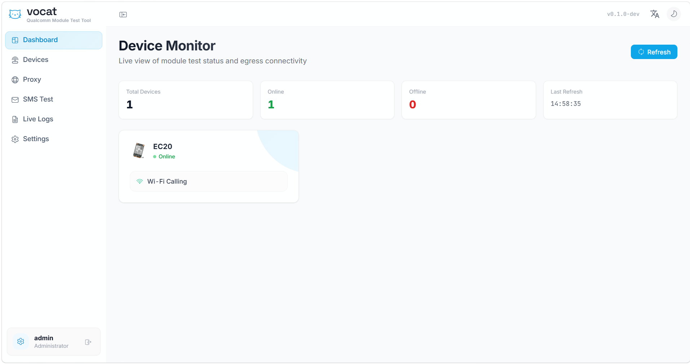
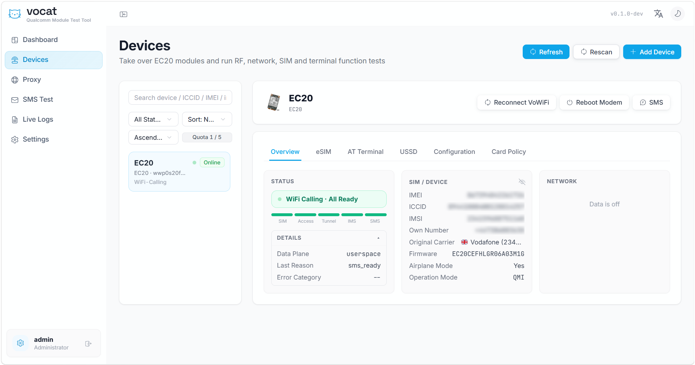

<p align="center">
  
</p>

<h1 align="center">VoNet</h1>

<p align="center">
  
  
  
  
  
  
</p>

<p align="center">
  
  
  
  
  
  
</p>

[English](../README.md) | [العربية](README.ar.md) | **简体中文** | [繁體中文](README.zh-TW.md) | [Français](README.fr.md) | [Русский](README.ru.md) | [Español](README.es.md) | [日本語](README.ja.md)

VoNet 是一款面向 Quectel EC20/EC25 系列蜂窝模组的开源 Web 控制面板与工程工具套件。它在一个自包含的服务中整合了模组发现、实时射频状态、AT 与 USSD 终端、短信、WiFi Calling（WiFi 通话）、eSIM 管理、网络选择、代理路由、通知、审计日志以及发布自动化。

后端使用 Go 编写，界面采用 React 与 TypeScript 构建，生产环境前端被嵌入进 Go 二进制中。单个可执行文件即包含完整的 Web 应用，并使用 SQLite 进行持久化存储。

<p align="center">
  
  
</p>

## 功能

| 领域 | VoNet 提供的能力 |
| --- | --- |
| 设备管理 | 自动串口/USB 发现、多模组支持、设备友好名称、概览实时刷新、模组重启、飞行模式以及 USB 网卡模式控制。 |
| 射频与网络 | 注册状态、运营商、信号指标、RSRP/RSRQ/SINR、网络模式、频段、信道、运营商扫描以及自动/手动选网。 |
| AT 与 USSD | 交互式 AT 终端、命令历史、原始模组响应、USSD 发起/继续/取消流程以及清晰的模组错误上报。 |
| 短信 | 蜂窝与 IMS 短信直接发送、入站同步、分段短信处理、送达报告、会话历史、未读状态、时间戳以及逐条消息的送达状态。 |
| WiFi Calling | IKEv2/ePDG 隧道建立、EAP-AKA 鉴权、IMS 注册、IMS 短信、重连控制、状态诊断以及按设备路由。 |
| eSIM 与 eUICC | eUICC 发现、EID 与生产信息、证书元数据、多 eUICC 清单、已安装配置文件列表、启用/禁用/切换操作，以及在卡片支持时进行下载、重命名和删除。 |
| 卡策略 | 基于 ICCID 的 WiFi Calling 与飞行模式行为，策略即时应用。 |
| 代理路由 | 上游 SOCKS 路由、设备绑定、国家规则、TCP 可达性检查以及面向 WiFi Calling 数据路径的 UDP Associate 检查。 |
| 通知 | 通过 Telegram、Bark、邮件、Pushplus 以及签名 Webhook 转发新入站短信，每条短信单独推送。 |
| Telegram 机器人 | 设备状态、已安装配置文件列表与切换、WiFi Calling 控制以及短信发送。敏感操作需要管理员确认。 |
| 运维 | 密码与 SSO 鉴权（Pocket ID、GitHub、Generic OAuth2）、CSRF 防护、访问策略、审计事件、实时日志、日志留存、健康检查、响应式布局、深色模式以及中英文应用界面。 |
| 分发 | 静态 Linux 二进制、systemd 安装脚本、带 SHA-256 校验的自更新、Docker 镜像、GHCR 发布以及 GitHub Actions 发布构建。 |

## 支持的硬件

VoNet 面向基于高通芯片、并暴露兼容 AT、QMI、串口与 USB 网络接口的 Quectel 模组，包括：

- Quectel EC20
- Quectel EC25
- Quectel EG25 系列
- 兼容的 EG600 及相关模组

可用功能取决于模组固件、USB 复合设备配置、SIM/eSIM 能力、主机驱动、无线网络以及运营商配置。

## 安装

### Linux 一键安装

已是 root（包括默认没有 `sudo` 的 OpenWrt/Kwrt）：

```bash
curl -fsSL https://raw.githubusercontent.com/springai/VoNet/master/scripts/install.sh | bash
```

普通 Linux 用户且系统装有 sudo：

```bash
curl -fsSL https://raw.githubusercontent.com/springai/VoNet/master/scripts/install.sh | sudo bash
```

只检查 VoWiFi/XFRM 环境，不安装 VoNet：

```bash
curl -fsSL https://raw.githubusercontent.com/springai/VoNet/master/scripts/install.sh | bash -s -- --check-env
```

安装指定版本：

```bash
curl -fsSL https://raw.githubusercontent.com/springai/VoNet/master/scripts/install.sh -o install.sh
sudo bash install.sh 0.0.2
```

VoWiFi IMS 必须使用 Linux XFRM/IPsec。OpenWrt/Kwrt 上安装脚本会从当前固件自己的软件源尝试安装严格匹配的 `ip-full`、`kmod-ipsec`、`kmod-ipsec4/6`、`kmod-crypto-authenc`、AES-CBC 和 SHA1 组件。若软件源没有与当前内核匹配的模块，必须更换包含这些组件的固件，禁止强装其他内核版本的 kmod。

如果内核无法提供 XFRM/IPsec，而你只需要蜂窝短信或数据等非 VoWiFi 功能，可使用 `--skip-vowifi-check` 安装：

```bash
curl -fsSL https://raw.githubusercontent.com/springai/VoNet/master/scripts/install.sh -o install.sh
sudo bash install.sh --skip-vowifi-check
```

安装程序会：

- 检测 `amd64`、`386`、`arm64`、`aarch64` 或 `armv7` 架构；
- 下载对应的 GitHub Release 二进制；
- 对照 `SHA256SUMS` 进行校验；
- 将 VoNet 安装到 `/opt/vonet`；
- 创建具有 VoNet 所需硬件与网络访问权限的强化版 systemd 服务；
- 将运行时配置存放在 `/etc/vonet/env`；
- 首次安装时生成随机初始管理员密码。

安装完成后打开：

```text
http://<server-address>:17575
```

### 手动二进制安装

从 GitHub Releases 下载对应的二进制与 `SHA256SUMS`：

| 平台 | 发布文件 |
| --- | --- |
| Linux x86-64 | `vonet-linux-amd64` |
| Linux x86 32 位 | `vonet-linux-386` |
| Linux ARM64 | `vonet-linux-arm64` |
| Linux AArch64 | `vonet-linux-aarch64` |
| Linux ARMv7 | `vonet-linux-armv7` |

校验并安装：

```bash
sha256sum -c SHA256SUMS --ignore-missing
sudo install -d -m 0755 /opt/vonet/bin /opt/vonet/data
sudo install -m 0755 vonet-linux-amd64 /opt/vonet/bin/vonet
read -rsp "Admin password: " VONET_BOOTSTRAP_PASSWORD; echo
printf '%s\n' "$VONET_BOOTSTRAP_PASSWORD" | sudo /opt/vonet/bin/vonet bootstrap-admin
unset VONET_BOOTSTRAP_PASSWORD
sudo env \
  VONET_DATABASE_PATH=/opt/vonet/data/vonet.db \
  /opt/vonet/bin/vonet serve
```

该手动命令会在前台运行 VoNet。请使用 `vonet serve` 以直接启动服务器；在 TTY 下以 root 运行无参数的 `vonet` 会进入交互式管理菜单。如需托管的 systemd 服务与自动重启，请使用一键安装脚本。

### Docker

如果 Linux 主机需要发现每一个接入的受支持 Quectel 模组，并持续感知 USB 热插拔事件，请以硬件访问模式运行 VoNet：

```bash
docker pull ghcr.io/mengmengcode/vonet:latest

read -rsp "Admin password: " VONET_BOOTSTRAP_PASSWORD; echo
printf '%s\n' "$VONET_BOOTSTRAP_PASSWORD" | docker run --rm -i \
  --user 0:0 \
  -v vonet-data:/opt/vonet/data \
  --entrypoint /opt/vonet/bin/vonet \
  ghcr.io/mengmengcode/vonet:latest bootstrap-admin
unset VONET_BOOTSTRAP_PASSWORD

docker run -d \
  --name vonet \
  --restart unless-stopped \
  --network host \
  --privileged \
  --user 0:0 \
  -v vonet-data:/opt/vonet/data \
  -v /dev:/dev \
  -v /sys:/sys:ro \
  ghcr.io/mengmengcode/vonet:latest
```

容器启动后打开 `http://<server-address>:17575`。必须使用主机网络，才能让 QMI 网络接口保持对 VoNet 可见；串口、QMI 控制节点、TUN 接口、网络配置以及容器启动后新增的设备则需要特权设备访问。`/dev` 绑定挂载使新的 `ttyUSB*`、`ttyACM*`、`cdc-wdm*` 和 MHI `wwan*` 节点无需重建容器即可见。

该模式有意赋予 VoNet 对主机设备和网络栈的广泛访问权限，请仅在受信任的 Linux 主机上使用。自动发现会识别受支持的 Quectel USB 模组（USB 厂商 ID `2c7c`），以及通过 Linux WWAN 子系统暴露的 PCIe/MHI 模组；它不能识别任意模组布局。仅用 `--device` 映射单个节点，例如 `/dev/ttyUSB2`、`/dev/cdc-wdm0` 或 `/dev/wwan0qmi0`，会将容器限定在这些固定节点上，无法提供完整的多设备或热插拔发现。

在 OpenWrt 主机上，fw4 的 input 链会拒绝来自其未管理接口的新连接，其中包括 VoNet 为每个 VoWiFi 会话创建的 TUN。VoNet 使用镜像内的 `nft` 安装范围很窄的 `vonet-ims-*` 放行规则。如果容器内 `nft` 无法读取主机规则集，请将 `VONET_NFT` 指向访问主机 `nft` 的 wrapper；ARMv7 上通常需要使用 `ld-musl-armhf.so.1`，不能直接假定 `uname -m` 与 musl loader 文件名相同。

例如，在主机创建 wrapper 并将其挂载到容器：

```bash
cat > /opt/vonet-host-nft <<'EOF'
#!/bin/sh
exec /host/lib/ld-musl-$(uname -m).so.1 \
  --library-path /host/usr/lib:/host/lib \
  /host/usr/sbin/nft "$@"
EOF
chmod 755 /opt/vonet-host-nft

# 在上面的 docker run 命令中追加：
#   -v /usr:/host/usr:ro \
#   -v /lib:/host/lib:ro \
#   -v /opt/vonet-host-nft:/usr/local/bin/host-nft:ro \
#   -e VONET_NFT=/usr/local/bin/host-nft
```

ARMv7 上请将 loader 路径替换为主机实际存在的 loader，例如
`/host/lib/ld-musl-armhf.so.1`。

GHCR 镜像发布为 `linux/amd64` 与 `linux/arm64`。

> [!TIP]
> **NAS / QNAP Container Station 部署说明**：
> 在 QNAP QTS / QuTS hero（Container Station）等 NAS 操作系统上，自定义的非 root 管理员账号和卷隔离机制可能导致 Docker 命名卷（例如 `-v vonet-data:/opt/vonet/data`）在一次性的 `bootstrap-admin` 初始化和后台服务容器中解析为不同的隔离路径，从而在 Web 登录时出现“密码错误”。
> 在 NAS 环境中，强烈建议初始化和运行时均以主机绝对路径的绑定挂载替代命名卷（例如 QNAP 上的 `-v /share/Container/vonet/data:/opt/vonet/data`），以保证 SQLite 数据库持久化存储的一致性。

### USB SIM 读卡器

USB SIM 读卡器使用 Linux PC/SC 服务。一键安装程序会在支持的软件包管理器上自动安装并启动 `pcscd` 及 CCID 驱动。Debian/Ubuntu 上等效的手动安装命令为 `apt install pcscd libccid`。如果 USB 已识别 CCID 读卡器，但 PC/SC 不可用，VoNet 会继续在添加设备对话框中显示该读卡器，并报告缺少的服务或驱动，而不是静默隐藏它。

### QMI 命令行工具

VoNet 使用 `qmicli` 验证 QMI 控制通道是否就绪，并使用 `qmi-proxy` 复用对该通道的访问。分组数据会话由内置 QMI WDS 客户端管理，而非使用 `qmi-network` 的 CID/PDH 状态文件。一键安装程序会安装并验证相应工具。手动部署时，Debian/Ubuntu 使用 `apt install libqmi-utils`；Arch Linux 使用 `pacman -S libqmi`，Alpine 使用 `apk add qmi-utils`，OpenWrt 使用 `opkg install qmi-utils`。

`vonet doctor --repair-dji-qmi` 会在更改任何 USB 驱动绑定或置位 DTR 之前检查 `qmicli`。如果该工具不可用，命令会停止并给出安装提示，保持设备当前状态不变。

### AT 蜂窝主机数据

AT 模式的 ECM/RNDIS 数据依赖 Linux、`iproute2` 和 BusyBox `udhcpc`。
VoNet 必须独占管理模组网络接口；请关闭该接口上的其他 DHCP 客户端和
NetworkManager 配置。VoNet 只维护 IPv4 DHCP 租约和标记策略路由，不修改
系统默认路由或全局 DNS。当前该路径仅支持 IPv4 服务。

## 配置

VoNet 先从 `VONET_CONFIG` 读取可选的 JSON 配置文件，再应用 `VONET_*` 环境变量。环境变量优先级更高。

| 环境变量 | 默认值 | 说明 |
| --- | --- | --- |
| `VONET_ADDR` | `0.0.0.0:17575` | HTTP 监听地址。 |
| `VONET_DATABASE_PATH` | `./data/vonet.db` | SQLite 数据库路径。 |
| `VONET_SESSION_TTL` | `24h` | 鉴权会话有效期。 |
| `VONET_SECURE_COOKIES` | `false` | 可选的全局强制 Secure 覆盖；不启用时各 HTTP/HTTPS 入口自动选择 Cookie 保护。 |
| `VONET_SHUTDOWN_TIMEOUT` | `10s` | 优雅关闭超时时间。 |
| `VONET_MAX_REQUEST_BODY_BYTES` | `1048576` | API 请求体最大字节数。 |
| `VONET_MCP_ENABLED` | `false` | 启用 `/mcp` AI 客户端端点。 |
| `VONET_PROBE_UNKNOWN_USB` | `false` | 显式选择后才用 AT 命令探测未知 USB 串口设备。 |
| `VONET_REPO` | `springai/VoNet` | 自更新器使用的受信任 GitHub 仓库，格式为 `owner/name`。 |
| `GITHUB_TOKEN` | 空 | 可选的 GitHub token，用于私有仓库或更高的 API 限额。 |

用户提供的 Apple 运营商配置包可通过 `vonet carrier import-ipcc` 转换为可审查、符合允许列表的运营商配置文件；参见 [docs/CARRIER_IPCC_IMPORT.md](CARRIER_IPCC_IMPORT.md)。

管理员凭据仅存储在 SQLite 中。使用 `vonet bootstrap-admin` 对空数据库执行一次初始化；环境变量和 JSON 配置不能设置或覆盖管理员用户名或密码。

请勿将 Telegram token、SMTP 密码、Webhook 密钥、SIM 凭据或其他私密数据存放在仓库中。请通过应用设置或受保护的环境文件来配置它们。

## API Token 与 MCP

非浏览器客户端访问相同的 `/api/...` 端点时，使用
`Authorization: Bearer vonet_...` API Token，不使用浏览器 Session Cookie 或
CSRF 流程。API Token 只接受 `vonet_...` 形式的 Token，不能用管理员密码或
浏览器 Cookie 代替；`/api/auth/*`、SSO 管理和管理员密码管理仍只接受浏览器
Session，并继续受 Session 绑定 CSRF 保护。

```bash
vonet token create --read-only --ttl 720h ci-runner  # Token 仅在此处显示一次
curl -H "Authorization: Bearer vonet_..." http://127.0.0.1:17575/api/devices
```

使用 `vonet token list` 查看 Token 清单，使用 `vonet token revoke <name>`
撤销 Token。API Token 以管理员权限执行；`--read-only` Token 只能使用
`GET`、`HEAD` 和 `OPTIONS` 操作，不能发送短信、切换 eSIM Profile、触发重连
或执行其他会改变硬件状态的已记录操作。唯一的已记录数据库副作用是
`GET /api/sms/thread` 会把对应消息标记为已读。轮换管理员密码或应用二进制
更新会撤销全部 Session 和 Token。请在首次执行 `bootstrap-admin` 后创建
Token；远程 Bearer 客户端还需要来源地址被访问策略允许，默认 `internal`
模式只服务私有网络。

`VONET_MCP_ENABLED` 默认为 `false`。设为 `true`（或在配置文件中设置
`mcp_enabled: true`）后，VoNet 会在 `http://<host>:17575/mcp` 通过 Streamable
HTTP transport 暴露 MCP 端点，并要求 Bearer Token 鉴权。工具覆盖设备状态、
短信会话和受保护的短信发送、eSIM Profile 列表与协调切换，以及 WiFi Calling
状态和重连。eSIM 能力仅限列出已安装 Profile 和切换已安装 Profile：
`esim_list_profiles` 对只读和读写 Token 均可用，`esim_switch_profile` 是写
工具，只注册在 read-write server 上，需要不带 `--read-only` 的 Token。
read-only Token 收到的工具列表会完全隐藏 `sms_send`、`esim_switch_profile`
和 `vowifi_reconnect` 等写工具，而不是把它们列为禁用状态。

原始 AT、eSIM 下载/删除/重命名、SIM PIN、网络选择和系统更新等敏感操作不会
暴露给 MCP，工具输出不包含 IMSI、SIM PIN 或激活码。MCP 短信发送沿用 VoNet
网页界面的目的地策略和全局限速，但不限制目的国家。MCP 消息使用蜂窝 AT
路径，不写入网页会话历史，因此不会复现网页界面的 IMS 优先/O2 SMS 行为。

Claude Code 客户端配置示例：

```json
{
  "mcpServers": {
    "vonet": {
      "type": "http",
      "url": "http://192.168.1.10:17575/mcp",
      "headers": { "Authorization": "Bearer vonet_..." }
    }
  }
}
```

设计记录参见 [API_MCP_DEVELOPMENT_PLAN.md](API_MCP_DEVELOPMENT_PLAN.md)。

## 单点登录

登录页支持 Pocket ID、GitHub 和通用 OAuth2/OpenID Connect 提供方，密码登录
始终保留。只有完成提供方配置并把外部身份绑定到唯一管理员后，SSO 才会启用。

`PublicOrigin` 只能包含已保存的对外 scheme、host 和可选端口，回调固定为
`/api/auth/sso/callback`。面向公网的生产入口必须使用 HTTPS；显式配置的
localhost、loopback 或私网 IP 浏览器入口可使用 HTTP 或 HTTPS。SSO 设置和
账号绑定只允许浏览器 Session 操作，并受 Session 绑定 CSRF 保护；API Token
和 MCP 不能管理 SSO。

SQLite 数据库保存提供方配置、绑定元数据和标记为敏感的 Client Secret。
数据库备份及 WAL 文件必须按凭据材料保护。二进制更新或管理员密码轮换会撤销
Session、API Token 和未完成的 SSO flow。恢复数据库备份后，必须先撤销旧凭据
并清理未完成 flow，再开放服务。

### 配置身份提供方

在**设置 → 单点登录（SSO）**中选择一个提供方，并统一按以下顺序操作：保持
SSO 关闭时保存配置、检查配置、绑定一个外部账号，最后才启用 SSO。其他外部
账号不能注册或成为管理员，即使邮箱与已绑定账号相同也不会自动合并。

配置 Pocket ID：

1. 为 VoNet 配置 HTTPS 根路径入口，例如 `https://vonet.example.com`。选择
   **Pocket ID**；公开地址初始使用浏览器访问地址，需要时编辑 **VoNet 公开
   地址**。保存凭据前即可复制回调地址：
   `https://vonet.example.com/api/auth/sso/callback`。
2. 在 Pocket ID 为 VoNet 单独创建 **Confidential** OIDC Client，登记精确回调
   地址，并确认目标用户或用户组获准使用该客户端。每个应用使用独立客户端和
   本地会话。
3. 在 VoNet 填写 Pocket ID 精确的公开 `APP_URL` 作为 Issuer，并填入该客户端的
   Client ID 和 Client Secret。VoNet 处理 Scopes 和 PKCE S256，并根据已验证的
   Discovery 元数据优先选择 `client_secret_basic`，其次 `client_secret_post`。
   保持 SSO 关闭并保存。
4. 检查已保存的配置，然后通过 Pocket ID Passkey 登录和授权绑定账号。配置检查
   只验证元数据和可达性；真实登录才能验证 Client Secret 和用户访问权限。
5. 启用并保存 SSO，在隐身窗口验证登录、返回原页面以及登录后的第一次写操作。

Issuer 按路径和尾斜杠精确匹配。Pocket ID 使用已验证 ID Token 的 `issuer + sub`
关联账号，不依赖 UserInfo 或邮箱。Discovery、授权、Token 和 JWKS 必须使用配置
的 Issuer origin。通过 `INTERNAL_APP_URL` 发布不同 origin 后端的部署不受支持，
Issuer 应继续填写公开 `APP_URL`。

GitHub：在 GitHub.com 新建 OAuth App，登记相同的精确回调地址；选择
**GitHub**，填写 Client ID 和 Secret，并依次执行保存、检查、绑定、启用。
端点固定为 GitHub.com，默认 scope 为 `read:user`，强制 PKCE S256，并以稳定
数值账号 ID 绑定。此预设不支持 GitHub Enterprise。

Generic OAuth2：除客户端凭据外，还需填写授权、Token 和 UserInfo URL，并配置
Scopes、顶层用户 ID 字段（默认 `id`）、Token 认证和 PKCE 兼容选项。UserInfo
通过 Bearer access token 请求；用户 ID 必须为非空字符串或整数，大整数保留全部
数字。默认使用 `client_secret_post` 和 PKCE S256，只有提供方确实不支持 PKCE
时才关闭。Generic OAuth2 不执行 OIDC ID Token 校验。

更换 Provider、Client ID、Issuer 或 Generic 身份端点/用户 ID 字段会切换身份
命名空间。旧 Secret 会被清除，必须显式重置绑定后才能再次启用 SSO。

### SSO 多浏览器入口

同一份已保存的提供方配置和外部绑定可服务已配置的 HTTPS 公网入口，以及显式
配置的本地/私网 HTTP 或 HTTPS 浏览器入口。必须在身份服务登记每个完整的回调
URL（`/api/auth/sso/callback`）。授权和 Token 交换始终使用 flow 创建时冻结的
回调；通过其他入口返回的回调会被拒绝。HTTP 仅接受 localhost、loopback 和
literal 私网 IP，不接受任意公网 HTTP host 或私网 DNS 名称。

IPv6 回调 host 使用浏览器的压缩拼写，包括十六进制 IPv4-mapped 地址。请登记
设置页显示的回调 URL。展开的 IPv6 拼写可以被识别，但身份服务必须接受规范化
后的回调 URL。

Session 和 CSRF Cookie 均为 host-only。多个浏览器入口共享 SSO 提供方配置和
外部绑定，但 Session 不跨 host；通过一个入口登录不会认证另一个主机名或 IP
literal。直接 TLS、反代后的已配置 HTTPS 公网入口和受信任的
`X-Forwarded-Proto` 会按入口自动选择 Secure Cookie。
`VONET_SECURE_COOKIES=true` 是可选的强制 Secure 覆盖；纯 HTTP 入口无法签发
所需 Cookie，会阻止登录或 Session 刷新。反向代理必须保留原始 `Host`，并从
客户端请求中清除不受信任的 `Forwarded` 和 `X-Forwarded-*` 头。

Session 和 CSRF Cookie 使用请求传输的保护级别，只能在可识别的 HTTPS 请求上
升级为 Secure。已有 Session 保留原保护级别；升级后使用 HTTPS 的用户应重新
登录，使新 Session 记录正确的 Cookie 策略。独立局域网 HTTP 入口无需重启
进程即可继续使用。HTTP 凭据在传输时不受加密保护。

### 网络、部署与 TLS

现有来源网络策略继续覆盖全部 SSO 路由。`PublicOrigin` 是根路径公开地址，不会从
转发 Host 推导。当前请求入口负责选择并冻结自己的回调；允许的多个入口共享
已保存的 SSO 配置和外部绑定。

VoNet 进程必须能够解析并连接 Discovery、Token、JWKS 和 UserInfo。每个 DNS
候选地址和实际拨号地址都会校验；loopback、link-local、云元数据、特殊用途和
特权网络会被拒绝。Pocket ID 与 Generic HTTPS 可使用受信任的公网或私网地址；
Generic HTTP Token/UserInfo 仅允许显式配置的私网后端；GitHub 固定端点仅允许公网。

私有 CA 必须安装到宿主机或容器信任库，不提供跳过 TLS 校验的开关。反向代理必须
保持已配置的公开 origin 和原始 Host，并清除不受信任的转发头。首期只支持根路径
部署，不支持把 SSO 发布在 URL 前缀下，回调地址也不从转发 Host 头推导。

当前 Compose 使用 host network，应在实际容器内验证 DNS、路由和 CA 信任，不能
假定桥接网络的 service name 可用。本地 Vite 开发时统一使用一个 loopback origin，
例如 `http://127.0.0.1:5173`，并让公开地址与身份平台登记的回调保持一致；IdP
出站网络例外仅用于测试 fixture。

### Session、CSRF 与凭据

Session 和 CSRF Cookie 保持 `SameSite=Strict`，短期 SSO flow Cookie 使用
`SameSite=Lax` 以支持顶层 GET 回调。SSO 设置和绑定操作只允许浏览器 Session，
写操作还要求 Session 绑定 CSRF；Bearer Token 和 MCP 不能管理 SSO。

Client Secret 以 sensitive SQLite setting 保存，不会回显给浏览器。第三方访问
Token 和身份 Token 不落盘。保存、停用 SSO 或解绑会撤销受影响的 SSO Session；
按现有策略保留密码 Session 和 API Token。修改管理员密码会撤销 Session/API
Token、推进 credential epoch、取消 pending flow，并保留外部绑定。

普通退出只结束当前 VoNet 会话。在 IdP 停用账号或退出 Pocket ID 不会立即撤销
已有 VoNet 会话；它会按 `VONET_SESSION_TTL` 到期，也可通过在 VoNet 停用 SSO
或解绑立即撤销。公开登录能力接口为 `GET /api/auth/providers`。

配置版本冲突返回 `409 sso_config_changed`；身份源变化返回
`409 sso_rebind_required`，必须显式清除旧绑定。转换尚未完成时也可能返回
`409 sso_binding_exists` 或 `409 sso_identity_not_bound`。

### 升级、备份与回滚

SSO 使用 VoNet schema 35，同时保留 migration 33 API Token、migration 34 SSO
存储和全部本地业务表。Schema 35 仅增加 `sessions.secure_cookies`，用于记录
每个 Session 的 Cookie 传输策略。完成配置和绑定前，SSO 始终禁用。升级前应
停止服务并备份完整数据目录，包括
SQLite、WAL/SHM、TLS、插件和 `/etc/vonet/env`。在线备份必须使用 SQLite backup
API 或 `.backup`，不能只复制主数据库文件。

恢复任何数据库备份后、开放服务前，执行：

```bash
vonet auth-cleanup --database /opt/vonet/data/vonet.db
```

该命令保留 SSO 配置和外部绑定，但会撤销恢复出来的 Session/API Token、推进
credential epoch 并清空 pending SSO flow。Schema 35 没有自动降级；回滚必须恢复
与旧二进制匹配的升级前快照。

Docker 升级应拉取镜像并重建容器。生产发布前应验证 HTTPS 根路径回调和安全
Cookie、完成真实 Pocket ID Passkey/访问策略联调、从部署所用 Compose 容器确认
DNS/路由/CA 信任，并演练 schema 35 升级、`vonet auth-cleanup` 和回滚流程。

### Cleanup health

VoNet 在启动时执行一次 SSO flow 清理，此后每分钟执行一次。清理失败时，
`/readyz` 返回 HTTP `503` 和
`{"status":"degraded","reason":"sso_cleanup"}`，`/metrics` 报告
`vonet_sso_cleanup_healthy 0`。后续清理成功后，`/readyz` 返回 HTTP `200`、
`"status":"ready"` 和 `"sso_cleanup_healthy":true`，`/metrics` 报告
`vonet_sso_cleanup_healthy 1`。

`vonet auth-cleanup` 是恢复数据库备份或有意退役恢复/过期鉴权状态时使用的
独立运维命令。它要求用户重新登录并创建新的 API Token，同时保留 SSO 提供方
配置和外部绑定，并只输出聚合完成结果。密码、Session/API Token 值、SSO
秘密以及备份和数据库内容不得写入日志、支持工单或健康输出；`/readyz` 和
`/metrics` 只暴露聚合清理状态。

## Telegram 机器人

启用 Telegram 通知并配置好 Chat ID 与 Admin ID 后，机器人支持：

```text
/status [device]
/esim <device>
/switch <device> <iccid>
/wfc <device> <status|on|off|reconnect>
/sms <device> <number> <message>
/ussd <device> <code>
/ussd_reply <session> <input>
/ussd_cancel <session>
```

配置文件切换与短信提交使用一次性确认按钮。机器人不暴露 eSIM 下载、删除或重命名命令。

网页终端与 Telegram 共用 USSD 路由。启用 WiFi Calling 时，请求使用 IMS/USSI；IMS 未就绪时会明确报错并提示等待注册，不会回退到蜂窝 AT+CUSD。关闭 WiFi Calling 时使用蜂窝 USSD。菜单回复与取消始终绑定原设备和会话。取消失败会返回错误并保留会话供重试；发送结果不确定时不会自动换通道重新提交。

USSI 会话处理遵循 [3GPP TS 24.390](https://www.etsi.org/deliver/etsi_ts/124300_124399/124390/18.00.00_60/ts_124390v180000p.pdf)。BYE 失败时保留取消记录，但开始取消后禁止继续提交菜单输入（[RFC 3261 第 15.1.1 节](https://www.rfc-editor.org/rfc/rfc3261.html#section-15.1.1)）。

## 更新

检查是否有更新的 GitHub Release：

```bash
vonet update --check --repo springai/VoNet
```

安装最新发布版：

```bash
sudo vonet update --repo springai/VoNet
```

更新器会下载与当前 Linux 架构匹配的二进制，使用已发布的 `SHA256SUMS` 进行校验，原子性地替换可执行文件，并在可用时重启 `vonet` systemd 服务。

Docker 安装的更新方式：

```bash
docker pull ghcr.io/mengmengcode/vonet:latest
```

拉取新镜像后重建容器。

## 开发

依赖要求：

- Go 1.27.3 或更新版本
- Node.js 20 或更新版本
- npm

运行前端开发服务器：

```bash
cd web
npm install
npm run dev
```

构建嵌入的前端并启动后端：

```bash
cd web
npm run build
cd ..
go run ./cmd/vonet
```

运行全部测试：

```bash
go test ./...
```

构建生产二进制：

```bash
go build -trimpath -ldflags "-s -w" -o vonet ./cmd/vonet
```

## 发布自动化

推送版本标签会触发两个 GitHub Actions 工作流：

- `release-binaries` 构建并发布 `amd64`、`386`、`arm64`、`aarch64` 与 `armv7` 二进制及 `SHA256SUMS`。
- `docker` 构建并向 GitHub Container Registry 发布多架构镜像。

```bash
git tag v0.2.0
git push origin v0.2.0
```

## 项目结构

```text
cmd/vonet/                  应用入口与 CLI
internal/device/            模组发现与设备控制
internal/modem/             AT 会话与响应处理
internal/server/            HTTP API、通知与内嵌 Web 服务器
internal/store/             SQLite 持久化
internal/update/            GitHub Release 自更新器
internal/vowifi/            IKE、EAP-AKA、IMS 与 WiFi Calling 运行时
scripts/install.sh          Linux 安装与更新脚本
web/src/                    React 与 TypeScript 前端
.github/workflows/          二进制与 Docker 发布自动化
```

## 负责任地使用

蜂窝模组与 eSIM 操作可能影响用户服务、已存储的配置文件、网络注册以及硬件状态。请做好备份，谨慎审视破坏性操作，并仅在您被允许操作所连接的硬件与网络资源的合法环境中使用本软件。

VoNet 不会绕过运营商鉴权、网络策略、硬件安全或 eSIM 信任要求。支持某项操作意味着 VoNet 能够向模组或 eUICC 发起该请求；但设备、配置文件、网络或运营商仍可能拒绝。

## 贡献

欢迎提交 Issue 与 Pull Request。请保持改动聚焦，在可行处附带测试，避免提交凭据或用户数据，并清晰地说明硬件相关行为。

提交改动前：

```bash
go test ./...
cd web && npm run build
```

## 致谢
- [Nodeseek.com](https://www.nodeseek.com) — 专注服务器的社群
- [Linux.do](https://linux.do) — 富有启发的技术社群
- [iniwex5](https://github.com/iniwex5) — 风格与功能指南

## 许可证

参见 [LICENSE](../LICENSE)。

<a href="https://star-history.dera.page/#springai/VoNet">
 <picture>
   <source media="(prefers-color-scheme: dark)" srcset="https://star-history.dera.page/svg?repos=springai/VoNet&theme=dark" />
   <source media="(prefers-color-scheme: light)" srcset="https://star-history.dera.page/svg?repos=springai/VoNet" />
   
 </picture>
</a>
